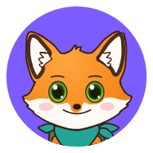
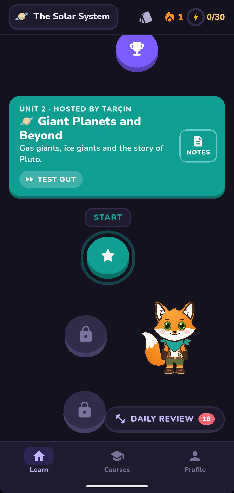
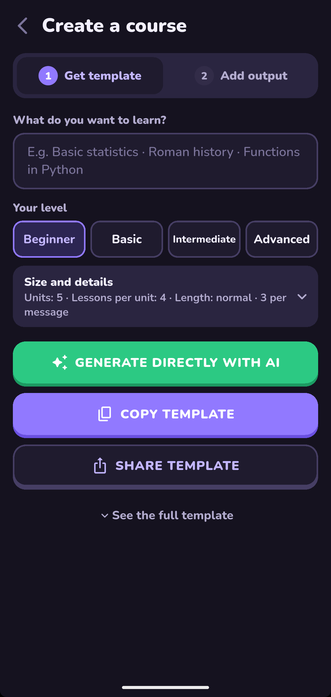
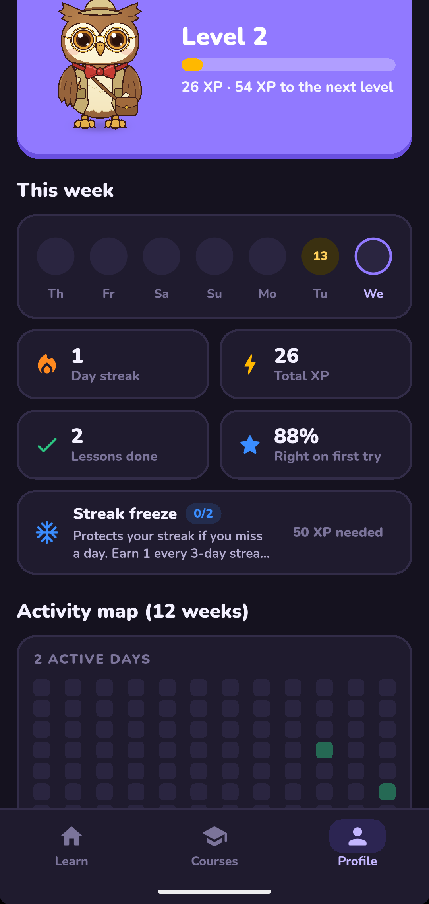
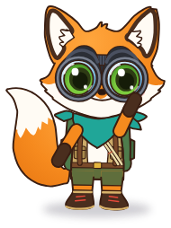
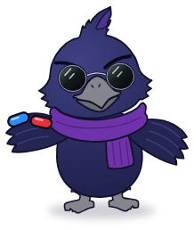
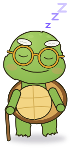
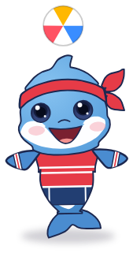

<div align="center">
  
  <h1>Bilge</h1>
  <p><a href="README.md">Türkçe</a> · <b>English</b></p>
</div>

An Android app that lets you learn any topic level by level, through play.
You choose the topic, an AI generates the content based on a **template**, and Bilge turns it into a game.

<p align="center">
  
  
  
</p>

## Features


- Courses on any topic, tailored to your level.
- Have any AI chat write a course from a template, or generate it right in the app with your own API key.
- 12 exercise types such as multiple choice, true/false, fill-in-the-blank, matching, ordering, and flashcards; support for formulas, charts, and text-to-speech.
- Levels, XP, streaks, badges, and the ability to test out of units you already know.
- Spaced repetition: due questions and past mistakes resurface in daily reviews.
- Lessons work offline; no accounts, ads, or tracking.
- Turkish and English interface, light and dark themes.
- Share courses as a single file or a bundle.

<br clear="right">

## Creating a course


1. Enter your topic and level.
2. Copy the template and paste it into any AI chat, or generate directly with your API key.
3. Paste the output into Bilge.

<br clear="right">

## Team

Bilge has a team of seven mascots. On first launch you pick your companion, and the mascots take turns hosting the units.

| <br>Puhu | <br>Tarçın | <br>Zifir | <br>Tosbi | <br>Paşa | <br>Sekiz | <br>Dalga |
| :-: | :-: | :-: | :-: | :-: | :-: | :-: |

## Sharing courses


A course is shared as a single `.bilge.json` file. When the recipient taps the file, Bilge opens and asks whether to add it. Content from shared courses is never run as code.

<br clear="right">

## Building from source

Flutter is required to build and run the app.

```sh
flutter pub get
flutter run
flutter build apk --release
```

## License

© 2026 Murat Boy

Bilge is free software: you can use, modify and redistribute it under the terms of the GNU General Public License, version 3 or (at your option) any later version (GPL-3.0-or-later). It comes with no warranty; see [LICENSE](LICENSE).

The Nunito fonts are distributed under the SIL Open Font License 1.1: [assets/fonts/OFL.txt](assets/fonts/OFL.txt).
