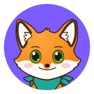
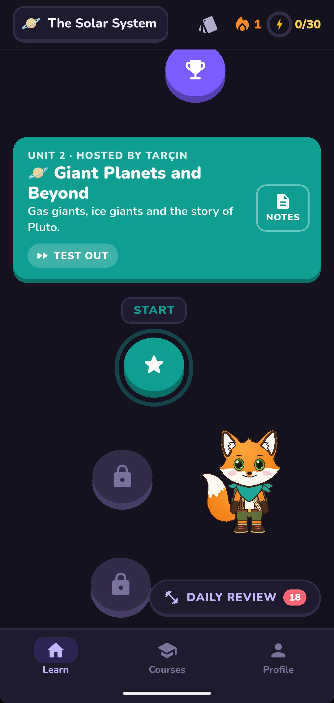
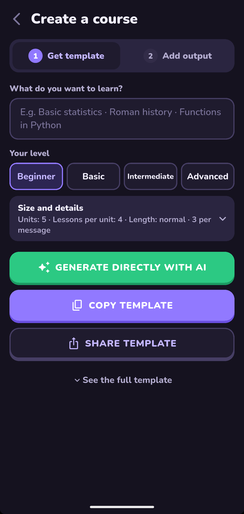
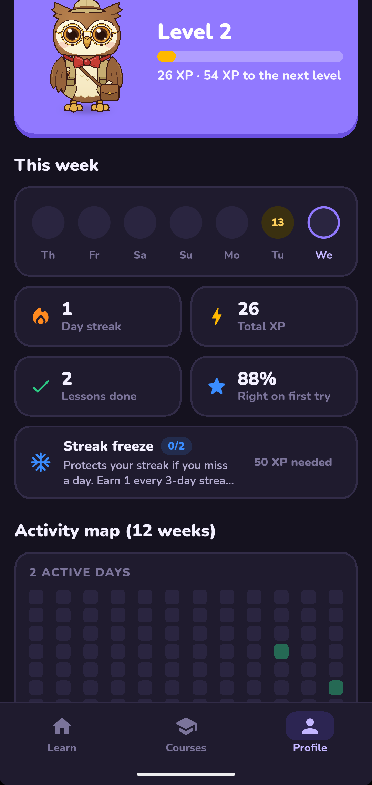
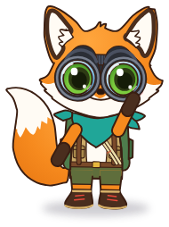
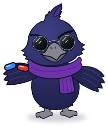
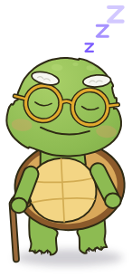
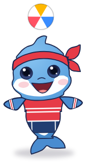

<div align="center">
  
  <h1>Bilge</h1>
  <p><b>Türkçe</b> · <a href="README.en.md">English</a></p>
</div>

İstediğin her konuyu seviye seviye, oynayarak öğrenmeni sağlayan Android uygulaması.
Konuyu sen seçersin, içeriği bir yapay zekâ **kalıba** göre üretir, Bilge de onu oyuna çevirir.

<p align="center">
  
  
  
</p>

## Özellikler


- Her konuda, kendi seviyene göre kurs.
- Kursu istediğin yapay zekâ sohbetine kalıpla yazdırırsın ya da kendi API anahtarınla uygulamada doğrudan üretirsin.
- Çoktan seçmeli, doğru-yanlış, boşluk doldurma, eşleştirme, sıralama, ezber kartı gibi 12 alıştırma türü; formül, grafik ve sesli okuma desteği.
- Seviyeler, XP, seri, rozetler ve bildiğin üniteleri sınavla atlama.
- Aralıklı tekrar: zamanı gelen sorular ve yanlışların günlük tekrarda yeniden karşına çıkar.
- Dersler internetsiz çalışır; hesap, reklam ve takip yok.
- Türkçe ve İngilizce arayüz, açık ve koyu tema.
- Kursları tek dosya ya da paket olarak paylaşma.

<br clear="right">

## Kurs oluşturma


1. Konuyu ve seviyeni yaz.
2. Kalıbı kopyalayıp istediğin yapay zekâ sohbetine yapıştır ya da API anahtarınla doğrudan üret.
3. Çıktıyı Bilge'ye yapıştır.

<br clear="right">

## Ekip

Bilge'de yedi kişilik bir maskot ekibi var. İlk açılışta yol arkadaşını seçersin, üniteleri sırayla onlar sunar.

| <br>Puhu | <br>Tarçın | <br>Zifir | <br>Tosbi | <br>Paşa | <br>Sekiz | <br>Dalga |
| :-: | :-: | :-: | :-: | :-: | :-: | :-: |

## Kurs paylaşma


Kurs tek bir `.bilge.json` dosyası olarak paylaşılır. Alan kişi dosyaya dokununca Bilge açılıp eklemeyi sorar. Dışarıdan gelen içerik hiçbir zaman kod olarak çalıştırılmaz.

<br clear="right">

## Kaynaktan derleme

Uygulamayı derlemek ve çalıştırmak için Flutter gereklidir.

```sh
flutter pub get
flutter run
flutter build apk --release
```

## Lisans

© 2026 Murat Boy

Bilge özgür yazılımdır: GNU Genel Kamu Lisansı'nın 3. sürümü ya da istersen daha sonraki bir sürümü (GPL-3.0-or-later) koşullarıyla kullanabilir, değiştirebilir ve dağıtabilirsin. Hiçbir garanti verilmez; ayrıntılar [LICENSE](LICENSE) dosyasında.

Nunito yazı tipleri SIL Open Font License 1.1 ile dağıtılır: [assets/fonts/OFL.txt](assets/fonts/OFL.txt).
